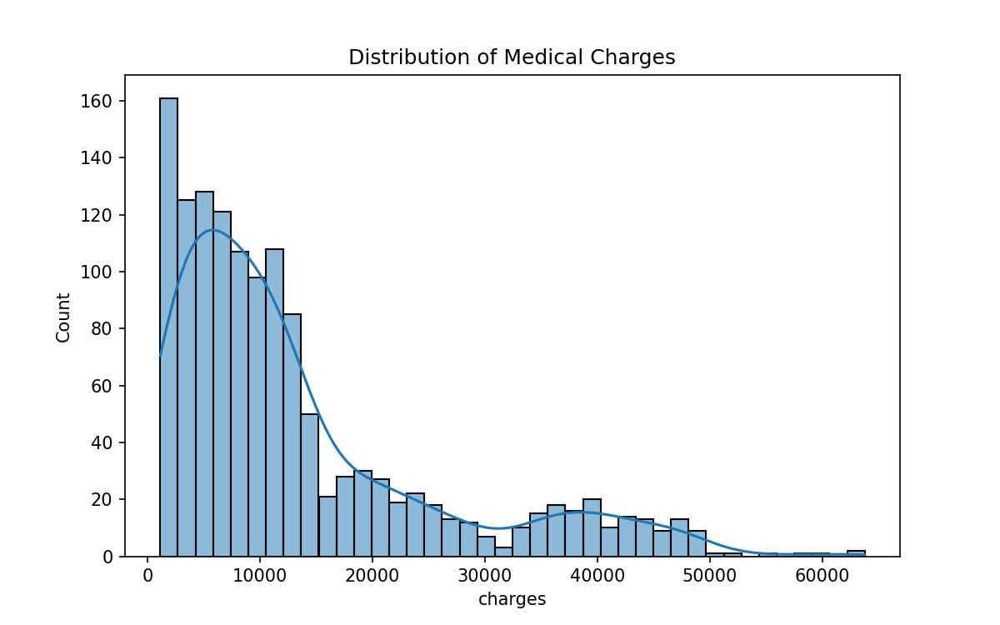
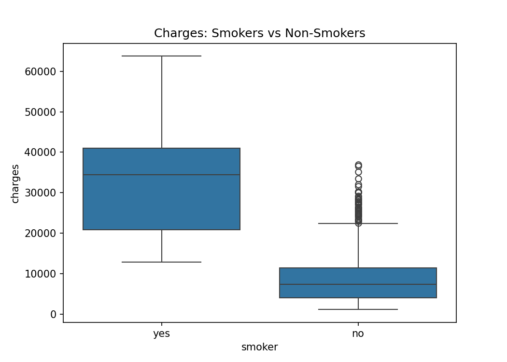
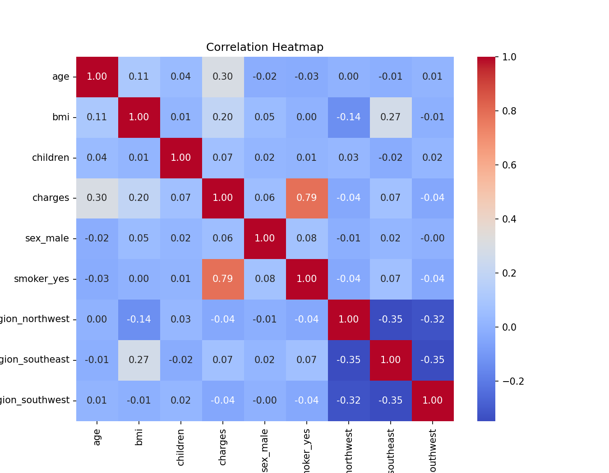
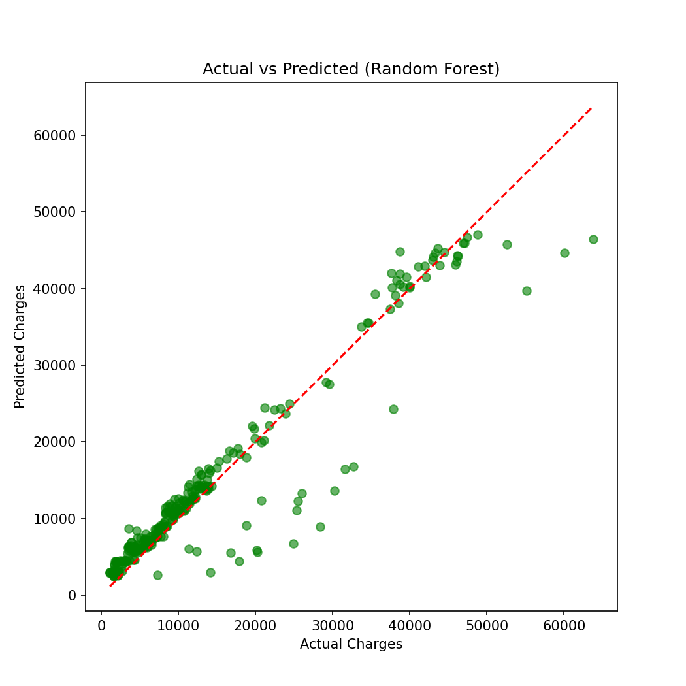

# Medical Cost Prediction using Machine Learning

A machine learning project that predicts a person's yearly medical insurance charges from age, sex, BMI, number of children, smoking status and region.

## Dataset
Medical insurance dataset with 1,338 people (age, sex, bmi, children, smoker, region, charges).

## Tools Used
Python, Google Colab, pandas, numpy, matplotlib, seaborn, scikit-learn

## Method
1. Cleaned the data and converted text columns to numbers (one-hot encoding)
2. Split the data: 80% training, 20% testing
3. Trained two models: Linear Regression and Random Forest
4. Compared the models using MAE, RMSE and R2 score

## Results

| Model | MAE ($) | RMSE ($) | R2 Score |
|---|---|---|---|
| Linear Regression | 4177 | 5956 | 0.807 |
| Random Forest | 2432 | 4253 | 0.902 |

Random Forest is the best model. Smoking is the most important factor affecting medical cost, followed by BMI and age.

## Graphs

## How to Run
Open the Python file in Google Colab and run it. The dataset downloads automatically.
